<div align="center">


### Run two teleprompter rigs in perfect lockstep — one keyboard and mouse drives both, over your local network.

No cloud. No subscription. No drift.

[](https://github.com/MaxFishman/teleprompter-sync-system/releases/latest)
[](CHANGELOG.md)
[](LICENSE)
[](#how-it-works)
[](#why-tss)

**[⬇ Download for macOS](https://github.com/MaxFishman/teleprompter-sync-system/releases/latest)** · **[Website](https://MaxFishman.github.io/teleprompter-sync-system/)** · **[Changelog](CHANGELOG.md)**

</div>

---

## Why TSS

Every serious live broadcast runs a **backup teleprompter** in case the primary laptop dies mid-show. The problem: keeping both rigs on the exact same line, by hand, under pressure, is a mistake waiting to happen.

**Teleprompter Sync System** links them. The operator uses **one** keyboard and mouse, and every connected rig — plus any phone or tablet you bring in as a remote — scrolls, pages, and clicks **together**, in real time, with no internet involved. If the primary fails, the backup is already exactly where it should be.

<div align="center">

</div>

> **◆ Latest improvements — reliability**
>
> - **🛟 Self-healing link** — rigs detect a dropped or half-open connection and reconnect on their own; a rig that silently falls behind is flagged **OUT OF SYNC**, and one **Re-home** button snaps every rig back to a known common line.
> - **🛑 Guaranteed All-stop** — critical commands (All-stop, Roll, Re-home) are re-delivered until every rig confirms — even a rig that was mid-reconnect still gets them, exactly once — and a crashed rig agent respawns itself.
> - **🗒️ Session log export** — download a timestamped timeline of the whole show (connects, drops, drift, all-stops, re-homes) for post-show review.

## What you get

| | |
|---|---|
| 🔒 **Redundant by design** | Drive the primary and one or more backups as a single surface. The spare is always in step. |
| ⌨️ **One operator, one surface** | Arrow keys, Page Up/Down, Home/End, Space — relayed to every rig at once. |
| 🖱️ **Mouse mirroring** | Mirror cursor moves and clicks to the backups (the host keeps its own mouse). |
| 🎚️ **Per-rig speed trim** | Each rig can scroll a little faster or slower so two different teleprompter apps stay aligned. |
| 📱 **Join from a phone or tablet** | Scan a QR code to turn any device into a wireless controller. |
| 🛰️ **Local network only** | Everything stays on your Wi-Fi/LAN. No accounts, no servers, no data leaves the room. |
| ✅ **Live sync confidence** | Every rig acknowledges each command — IN SYNC / DRIFT status, per-rig latency, and connect/drop alerts. |
| 🔐 **Locked & armed** | A session PIN plus arm/disarm keep random devices and stray keys off air. |
| 🎬 **Roll & instant all-stop** | A 3·2·1 roll countdown starts every rig together; one panic key halts them all. |
| 🔦 **Identify any rig** | Beep + banner a specific laptop so you always know which physical machine is which. |
| 🧭 **Guided first-run tour** | A built-in walkthrough points out every control the first time you open the console. |
| 🤝 **One operator at a time** | Control handoff + view-only, so a second operator or a phone can watch without fighting for control. |
| 🎹 **MIDI control** | Map a MIDI controller's keys, pads, and knobs to any TSS action. |
| ✅ **Pre-show readiness** | One click confirms rigs, sync, arm, permission, and helpers before you go live. |
| 🔎 **Zero-config join** | Backup rigs discover the host over the network — no IP to type. |
| 🪟 **One-window console** | Every control is visible at once — no scrolling to reach a button under pressure. |
| 🎯 **Targeted, safe input** | Name the teleprompter app up front; keystrokes only ever reach that app, never the console. |
| 🛟 **Self-healing link** | Rigs reconnect automatically after a drop or Wi-Fi blip; a rig that falls behind is flagged **OUT OF SYNC** with one-tap **Re-home** recovery, and a crashed rig agent respawns itself. |
| 🛑 **Guaranteed critical commands** | All-stop, Roll and Re-home are re-delivered until every rig acks — even one that was mid-reconnect — and never double-fire. |
| 🗒️ **Session log export** | Download a timestamped timeline of the show — connects, drops, drift, all-stops, re-homes — for post-show review. |

## A closer look

Every control lives in one window, and every move is mirrored to each rig. Here it is, piece by piece.

### Transport — scroll & page as one
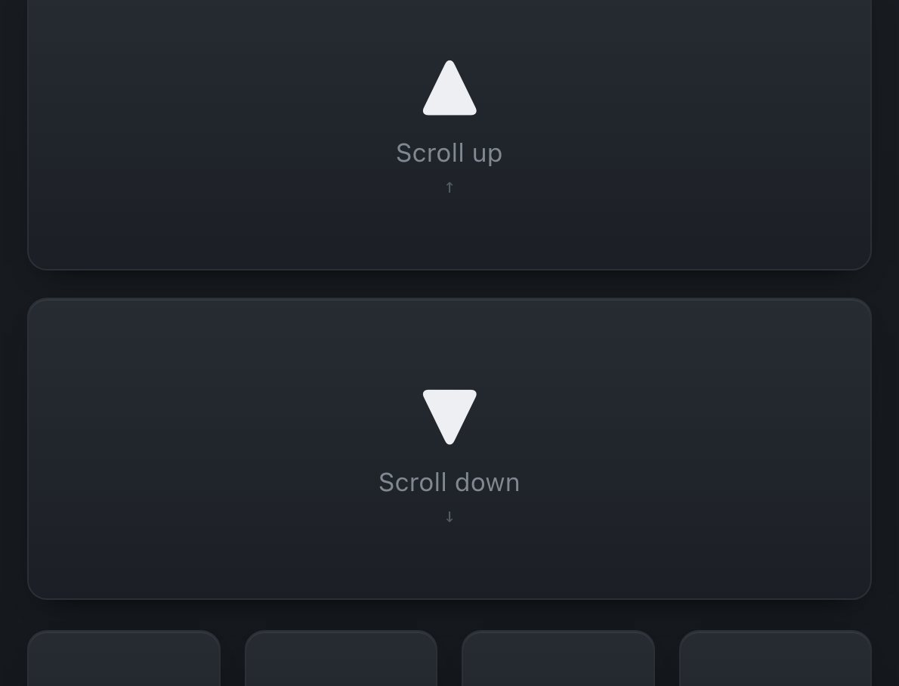

Oversized keys drive line scroll, Page Up/Down, and jump to top/bottom — fired to every rig the instant you press, by touch or keyboard.

### Roll & all-stop — start together, stop instantly
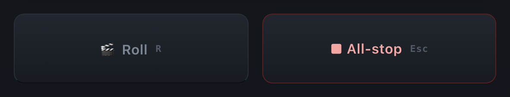

**Roll** runs a 3·2·1 countdown then starts every rig together; **All-stop** halts the auto-scroll crawl and pauses every rig on the spot — your panic button. Keys `R` and `Esc`.

### Master speed — set the pace for all rigs
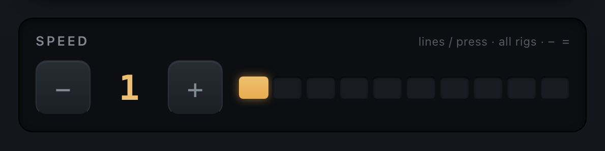

One control sets how far every rig scrolls per press, with a live level meter. Tap `−` / `=` or use the on-screen stepper.

### Per-rig trim — fine-tune each rig
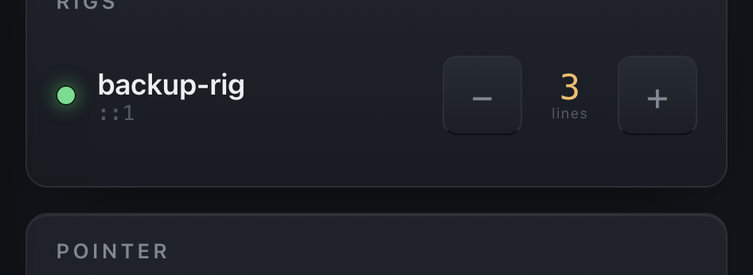

A live list of connected rigs, each with its own speed stepper — so two teleprompter apps that scroll at different rates still stay line-for-line.

### Identify — find the right laptop
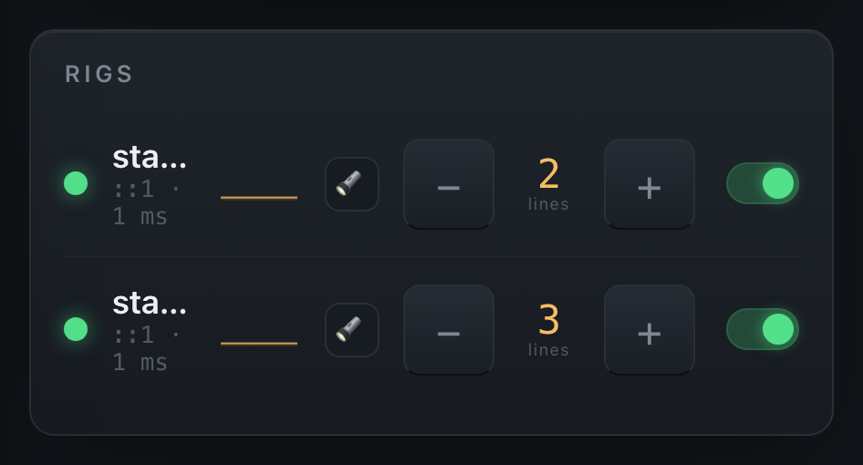

Every rig shows live latency and a sparkline. The 🔦 button makes that physical laptop **beep and flash a banner**, so you always know which machine is which — and the toggle drops a rig from the sync set without disconnecting it.

### Pointer — mirror the mouse
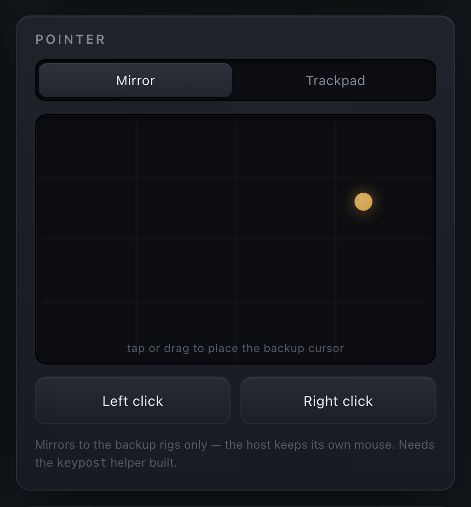

Move and click on the backups from a **Mirror** (absolute) or **Trackpad** (relative) surface, plus dedicated left/right click. The host keeps its own mouse.

### Join — bring in a phone or tablet
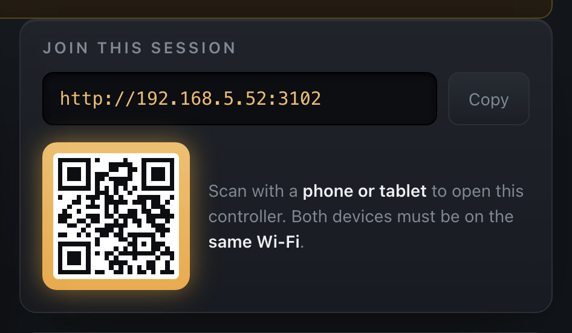

A scannable **QR** and copyable URL put the full controller on any device on the same Wi-Fi — a wireless remote in seconds.

### Activity HUD — always know it's live
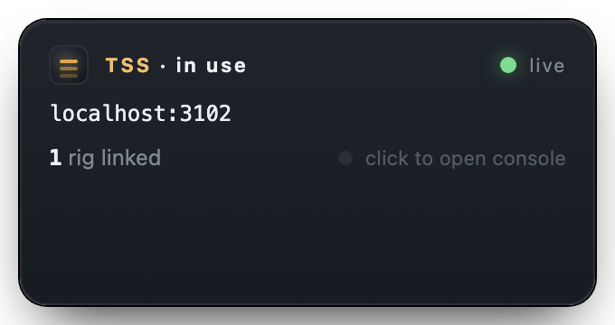

When the console isn't focused, a floating widget shows link status, rig count, and a live command ticker. Click it to jump back.

### Host or join in one tap
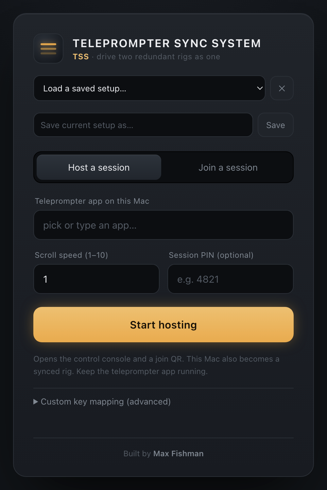

The native app bundles the hub, agent, and injector. Pick a role and go — no Terminal, no config files. Save **presets**, pick your teleprompter app from a list, or remap keys if it uses different ones.

## Production-grade control

Everything a live show needs to trust the backup and run it from anywhere.

### Built to not surprise you

The console is laid out to fit **one window** — transport, roll/all-stop, speed, your rigs and sync state are all visible at once, so there's no scrolling to hunt for a control the moment it matters. Mouse-wheel control is **opt-in** (a *Wheel drives rigs* toggle, off by default), so scrolling the window never moves the prompters by accident. And when you host, TSS drives **only** the teleprompter app you name — keystrokes can never loop back into the console. Quiet, predictable, show-safe.

### Self-healing link & guaranteed stops

Live networks blip — TSS is built to survive it. A rig that loses its connection (a Wi-Fi drop, a sleep, a half-open socket) **reconnects on its own** within seconds instead of hanging silently behind; the hub actively drops a rig that goes quiet so your rig count is always honest. A rig that was gone long enough to miss commands is flagged **OUT OF SYNC** in the console, and a single **Re-home** snaps every rig back to a known common line. The show-critical commands — **All-stop, Roll, Re-home** — are re-delivered until every rig confirms, so a rig that was mid-reconnect the instant you hit All-stop still stops the moment it returns (and never double-fires). If a rig's agent ever crashes, the host **respawns it automatically**.

### Session log — review the whole show

One tap (**⤓ Log**) downloads a timestamped timeline of everything that happened — session start, every rig connect / reconnect / drop (with the reason), arm/disarm, all-stops, re-homes, control handoffs — as a plain-text file for post-show review or a fault report.

### Know you're in sync
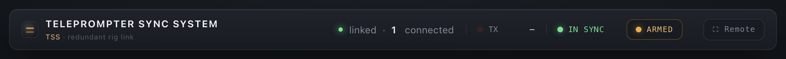

Every rig acknowledges each command. The header shows a live **IN SYNC / SYNCING / DRIFT** state, **per-rig latency**, and connect/drop alerts — so you always know both rigs agree.

### Lock it down
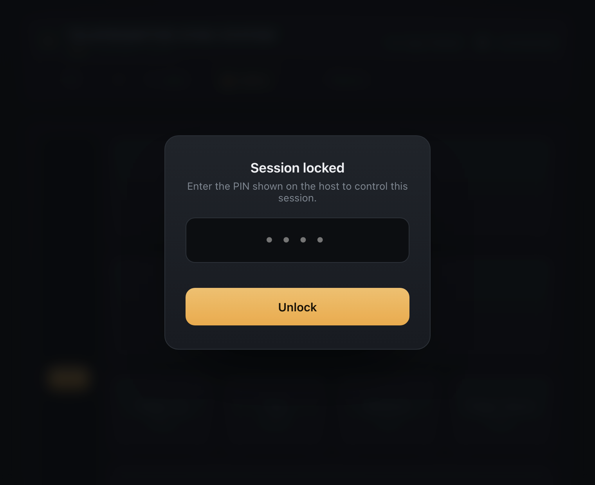

Set a **session PIN** so only trusted devices can control the show, and **Arm / Disarm** to stop stray keys ever reaching air.

### Auto-scroll
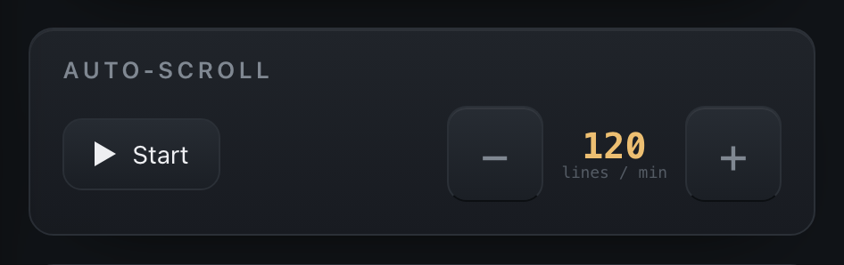

A steady, adjustable WPM-style crawl pushed to every rig — play or pause with one tap.

### Phone Remote mode
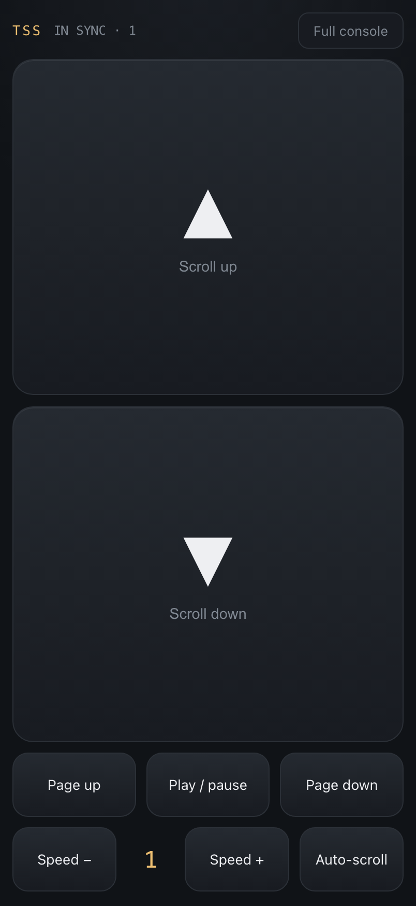

Scan the QR and your phone becomes a full-screen rocker — scroll, page, play, and speed, sized for a thumb.

### Always within reach
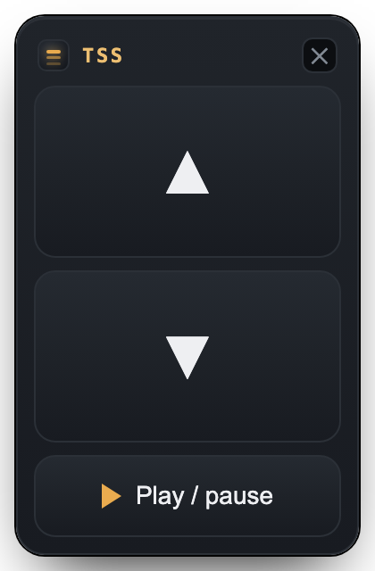

A tiny always-on-top transport (**⌘⇧M**), **global hotkeys** that work with the console unfocused, and a **menu-bar tray** that keeps hosting in the background.

### Learn it in a minute — guided tour
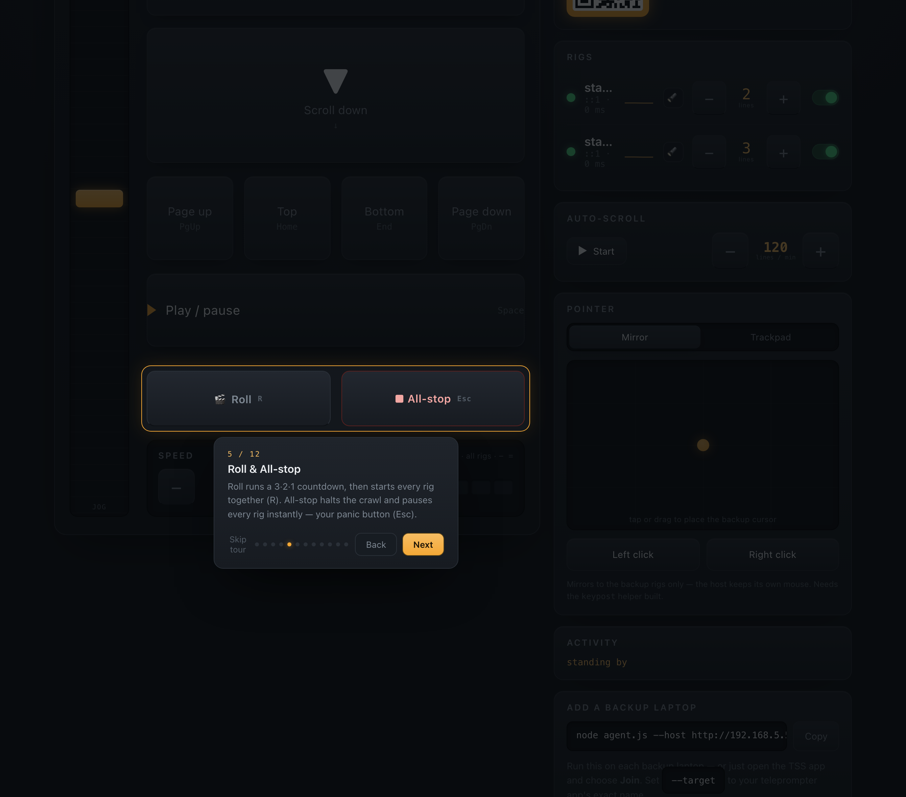

The first time you open the console, a built-in walkthrough spotlights each control in turn — transport, roll/all-stop, speed, auto-scroll, your rigs, sync state, arm and more. Skip or step through at your pace; replay it any time.

### Every shortcut at a glance
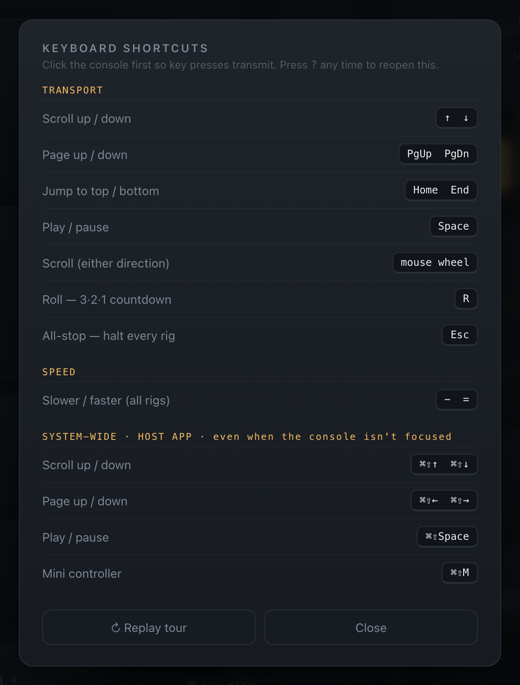

Press `?` for a cheat-sheet of every console and system-wide shortcut — and a one-click **Replay tour**.

### Pass control cleanly — handoff & view-only
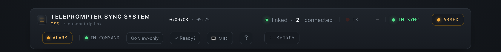

Only the controller **in command** can drive, so a second operator — or a phone in the gallery — can watch without fighting for control. The header shows who's driving; **Take control** hands it over cleanly, **Go view-only** releases it, and a silent commander auto-releases so nobody gets locked out.

### Drive from a MIDI controller
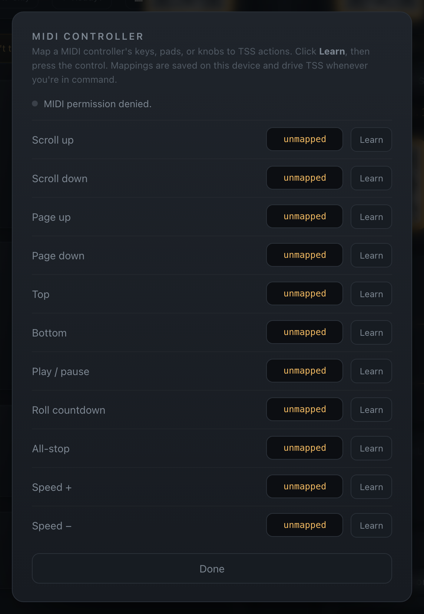

Map a MIDI controller's keys, pads, or knobs to any TSS action — scroll, page, top/bottom, play, roll, all-stop, speed. Click **Learn**, press the control, done. Mappings are saved per device and drive TSS whenever you're in command.

### One-click pre-show readiness
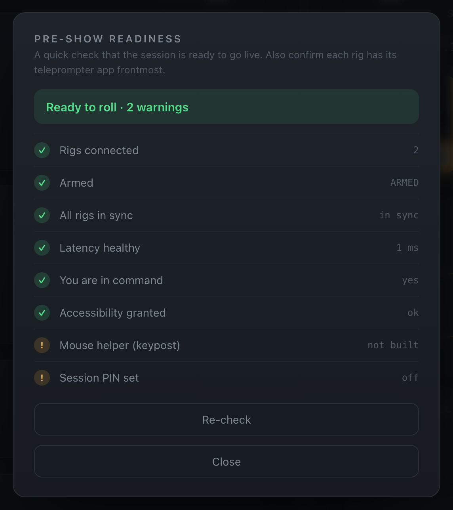

Before you go live, one check confirms rigs are connected, armed, in sync, latency is healthy, you're in command, Accessibility is granted, the mouse helper is built, and a PIN is set — with a clear **Ready to roll** or **Not ready** verdict.

### Join without typing an IP
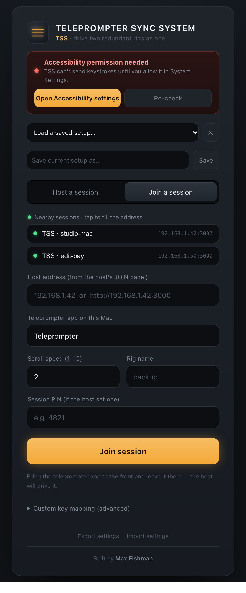

Hosts announce themselves on the network, so backup rigs just tap a **Nearby session** to join — no IP address to read out. The launch screen also walks you through **Accessibility permission** if it's missing, and you can **export/import** your presets and key maps between machines.

## Quick start

1. **Download & install** — grab the [latest DMG](https://github.com/MaxFishman/teleprompter-sync-system/releases/latest), drag **Teleprompter Sync System** to Applications, and open it. (First launch of an unsigned app: right-click → **Open**.)
2. **Host** — on the laptop with the keyboard, choose **Host a session**, **pick your teleprompter app** (required — it's the only app TSS will drive), and hit **Start hosting**. The console opens with a join QR.
3. **Join** — on each backup laptop, open TSS → **Join a session** → enter the host address shown on the host. On a phone or tablet, just **scan the QR**.

Drive from the console (or press keys / move the mouse) — every rig follows. That's it.

> **One-time:** macOS will ask for **Accessibility** permission the first time TSS sends input — System Settings → Privacy & Security → Accessibility → enable **Teleprompter Sync System**.
>
> **Updates:** TSS checks GitHub for new versions on launch — when one's available you can download and install it right from the app (or **Check for Updates…** in the menu bar).

## Requirements

- **macOS 11 or later** on each laptop.
- All devices on the **same Wi-Fi / LAN**.
- Your teleprompter application installed on each rig (TSS drives whatever app you name — it isn't a teleprompter itself).

## How it works

TSS runs a tiny hub on the host over your local network. Commands fan out to each rig, where a focus-safe helper injects **real** macOS key and mouse events into the teleprompter app you named — and only that app, so input never leaks into the console or anything else on screen. The app you already use just works, on every machine at once. Nothing is recorded; nothing leaves your network.

<details>
<summary><b>Run from source / build the DMG yourself</b></summary>

Needs [Node.js](https://nodejs.org) and Xcode command line tools (`xcode-select --install`).

```bash
git clone https://github.com/MaxFishman/teleprompter-sync-system.git
cd teleprompter-sync-system
npm install
npm start          # run the app unpackaged
npm run dist       # build dist/Teleprompter-Sync-System-<version>.dmg
```

**Without the app** (scripts only): on the host run `node server.js` + `node agent.js --host http://localhost:3000 --target "Your App" --name host --no-mouse --guard-frontmost` (the `--guard-frontmost` flag keeps the host from ever typing into its own console), open `http://localhost:3000`, and on each backup run `node agent.js --host http://<host-ip>:3000 --target "Your App"`. Full agent flags and the architecture notes live in [`CHANGELOG.md`](CHANGELOG.md) and inline in `server.js` / `agent.js`.

Key pieces: `server.js` (hub), `agent.js` (per-rig injector), `keypost.swift` (focus-safe key + mouse injection), `public/` (the console), `electron/` (the macOS app), `docs/` (this site).

</details>

## License

[MIT](LICENSE) © Max Fishman

<div align="center"><sub>Built by <b>Max Fishman</b> · Teleprompter Sync System · TSS — two rigs, one operator, zero drift.</sub></div>
