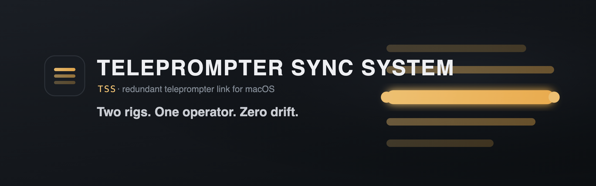
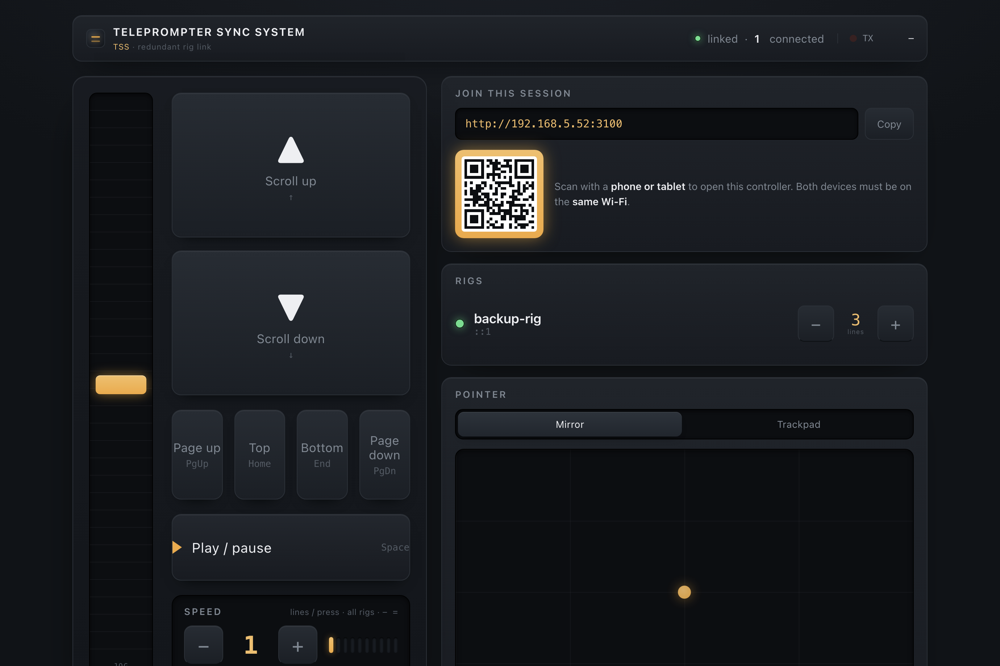

<div align="center">



### Run two teleprompter rigs in perfect lockstep — one keyboard and mouse drives both, over your local network.

No cloud. No subscription. No drift.

[](https://github.com/MaxFishman/teleprompter-sync-system/releases/latest)
[](CHANGELOG.md)
[](LICENSE)
[](#why-tss)

**[⬇ Download for macOS](https://github.com/MaxFishman/teleprompter-sync-system/releases/latest)** · **[Website](https://MaxFishman.github.io/teleprompter-sync-system/)** · **[Changelog](CHANGELOG.md)**

</div>

---

## Why TSS

Every serious live broadcast runs a **backup teleprompter** in case the primary laptop dies mid-show. The problem: keeping both rigs on the exact same line, by hand, under pressure, is a mistake waiting to happen.

**Teleprompter Sync System** links them. The operator uses **one** keyboard and mouse, and every connected rig — plus any phone or tablet you bring in as a remote — scrolls, pages, and clicks **together**, in real time, with no internet involved. If the primary fails, the backup is already exactly where it should be.

<div align="center">

</div>

## What you get

| | |
|---|---|
| 🔒 **Redundant by design** | Drive the primary and one or more backups as a single surface. The spare is always in step. |
| ⌨️ **One operator, one surface** | Arrow keys, Page Up/Down, Home/End, Space — relayed to every rig at once. |
| 🖱️ **Mouse mirroring** | Mirror cursor moves and clicks to the backups (the host keeps its own mouse). |
| 🎚️ **Per-rig speed trim** | Each rig can scroll a little faster or slower so two different teleprompter apps stay aligned. |
| 📱 **Join from a phone or tablet** | Scan a QR code to turn any device into a wireless controller. |
| 🛰️ **Local network only** | Everything stays on your Wi-Fi/LAN. No accounts, no servers, no data leaves the room. |

## Quick start

1. **Download & install** — grab the [latest DMG](https://github.com/MaxFishman/teleprompter-sync-system/releases/latest), drag **Teleprompter Sync System** to Applications, and open it. (First launch of an unsigned app: right-click → **Open**.)
2. **Host** — on the laptop with the keyboard, choose **Host a session**, type your teleprompter app's name, and hit **Start hosting**. The console opens with a join QR.
3. **Join** — on each backup laptop, open TSS → **Join a session** → enter the host address shown on the host. On a phone or tablet, just **scan the QR**.

Drive from the console (or press keys / move the mouse) — every rig follows. That's it.

> **One-time:** macOS will ask for **Accessibility** permission the first time TSS sends input — System Settings → Privacy & Security → Accessibility → enable **Teleprompter Sync System**.

## Requirements

- **macOS 11 or later** on each laptop.
- All devices on the **same Wi-Fi / LAN**.
- Your teleprompter application installed on each rig (TSS drives whatever app you name — it isn't a teleprompter itself).

## How it works

TSS runs a tiny hub on the host over your local network. Commands fan out to each rig, where a focus-safe helper injects **real** macOS key and mouse events into your teleprompter app — so the app you already use just works, on every machine at once. Nothing is recorded; nothing leaves your network.

<details>
<summary><b>Run from source / build the DMG yourself</b></summary>

Needs [Node.js](https://nodejs.org) and Xcode command line tools (`xcode-select --install`).

```bash
git clone https://github.com/MaxFishman/teleprompter-sync-system.git
cd teleprompter-sync-system
npm install
npm start          # run the app unpackaged
npm run dist       # build dist/Teleprompter-Sync-System-<version>.dmg
```

**Without the app** (scripts only): on the host run `node server.js` + `node agent.js --host http://localhost:3000 --target "Your App" --name host --no-mouse`, open `http://localhost:3000`, and on each backup run `node agent.js --host http://<host-ip>:3000 --target "Your App"`. Full agent flags and the architecture notes live in [`CHANGELOG.md`](CHANGELOG.md) and inline in `server.js` / `agent.js`.

Key pieces: `server.js` (hub), `agent.js` (per-rig injector), `keypost.swift` (focus-safe key + mouse injection), `public/` (the console), `electron/` (the macOS app), `docs/` (this site).

</details>

## License

[MIT](LICENSE) © Fishman

<div align="center"><sub>Teleprompter Sync System · TSS — two rigs, one operator, zero drift.</sub></div>
